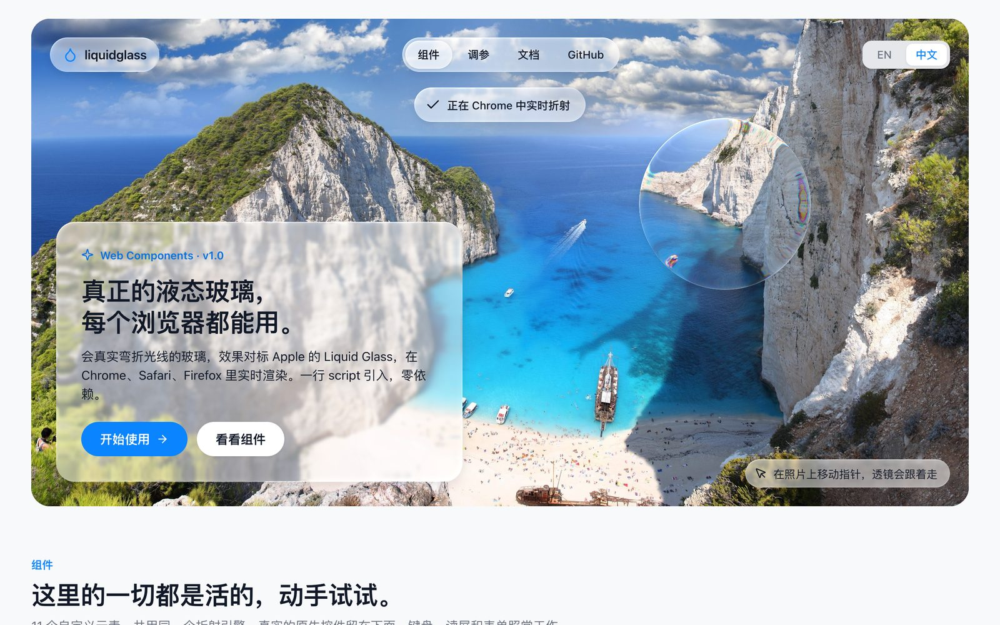
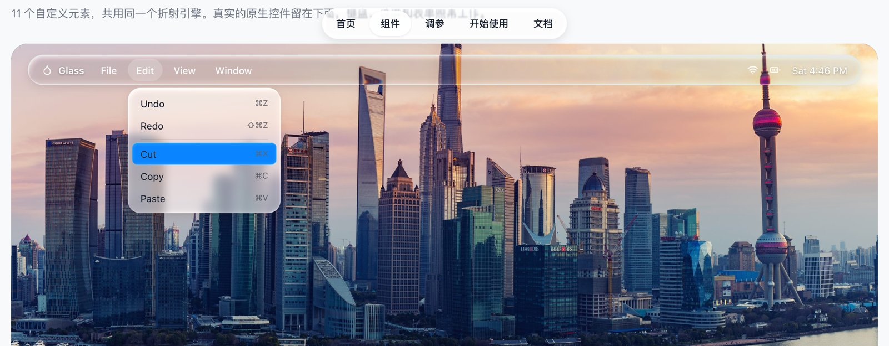

# Liquid Glass for the Web

Glass that actually bends light — like Apple’s Liquid Glass — rendered live in **Chrome, Safari and Firefox**. Web components plus a zero-dependency refraction engine, and a skill that teaches AI coding agents to build it.

**[liquidglass.dev](https://liquidglass.dev)** · [Docs](https://liquidglass.dev/docs/) · [Playground](https://liquidglass.dev/#playground) · [中文说明](#中文说明)



## Why

Most web liquid-glass demos put an SVG filter in `backdrop-filter: url()`. Only Chromium renders that; Safari and Firefox show nothing. This library bends the element’s **own** pixels with an SVG `feDisplacementMap` applied through a plain CSS `filter` — the one form every engine renders. Glass floating over a photo refracts an aligned copy of that photo, so it works everywhere. The displacement map is generated at runtime from each lens shape, and the engine compensates for the ways WebKit and Gecko differ from Blink (measured, not guessed).



## Quick start

```html
<script type="module" src="https://liquidglass.dev/lib/components.js"></script>

<lg-switch checked>Wi-Fi</lg-switch>
<lg-slider value="40" label="Volume"></lg-slider>
<lg-segmented value="week">
  <button value="day">Day</button>
  <button value="week">Week</button>
</lg-segmented>
```

Glass over an image — mark the backdrop and everything inside refracts it in every browser:

```html
<div class="hero" data-lg-backdrop="img">
  
  <lg-navbar>
    <a href="/" aria-current="page">Home</a>
    <a href="/docs">Docs</a>
  </lg-navbar>
  <lg-button tone="tinted">Continue</lg-button>
</div>
```

```js
import { toast } from 'https://liquidglass.dev/lib/components.js';
toast('Saved to Photos', { icon: 'check' });
```

Self-hosting: copy `lib/liquid-glass.js` and `lib/components.js` side by side. The hosted files are served with CORS, so other sites can import them directly.

## Components

| Element | What it is |
|---|---|
| `<lg-switch>` | Native checkbox; the thumb is solid white at rest and turns into glass while pressed |
| `<lg-slider>` | Native range input with a gently refracting glass thumb |
| `<lg-segmented>` | Radio group whose selection indicator is a springy glass lens |
| `<lg-button>` | Glass capsule that squishes on press; `tone="tinted"` / `"light"`, `href` for links |
| `<lg-panel>` | Frosted glass card |
| `<lg-navbar>` | Glass capsule with an indicator that follows the pointer |
| `<lg-menubar>` + `<lg-menu>` | Glass-rod menu bar; menus open as frosted panels with a sliding highlight |
| `toast()` | Toasts that drop in on a spring and stretch as they land |
| `<lg-dock>` | Glass shelf with a magnifying lens that follows the pointer |
| `<lg-lens>` | Wraps any content in a lens that follows the pointer |

Attributes, events, theming variables and the core API are in the [docs](https://liquidglass.dev/docs/).

## Core API

```js
import { createGlass, createSpring } from 'https://liquidglass.dev/lib/liquid-glass.js';

const glass = createGlass(element, { x: 40, y: 40, width: 180, height: 120, radius: 60, refraction: 28 });
glass.update({ x: 120 });      // moving is cheap: only the filter region shifts
glass.update({ width: 200 });  // reshaping regenerates the map (cached)
glass.destroy();
```

`lib/glass-webgl.js` renders the same lenses in WebGL for surfaces SVG filters can’t reach — a playing `<video>` in Safari, or canvas content.

## Browser support

| | Chrome · Edge | Safari · iOS | Firefox |
|---|---|---|---|
| Controls, lens, glass over a marked image | refraction | refraction | refraction |
| Glass over arbitrary page content | refraction | frosted blur | frosted blur |

Verified by rendering the same pages in Chrome 153, Safari 27 (WebKit) and Firefox 156 and comparing screenshots at full resolution.

## AI agent skill

`skill/liquid-glass-web` is a skill for **Claude Code** and **Codex**. It teaches the agent the technique, the per-engine fixes (why a naive filter is blank in Safari, how each engine scales displacement), component patterns and tuning values, and gives it scripts to screenshot a page in Chrome, WebKit and Firefox so it can check its own work.

Install (copies into `~/.claude/skills` and/or `~/.codex/skills`, whichever exist):

```bash
curl -fsSL https://liquidglass.dev/install-skill.sh | sh
```

Or manually:

```bash
git clone https://github.com/gentpan/liquidglass.git
cp -r liquidglass/skill/liquid-glass-web ~/.claude/skills/   # Claude Code
cp -r liquidglass/skill/liquid-glass-web ~/.codex/skills/    # Codex
```

Then ask for it in plain words — “add a liquid glass navbar over the hero image”, “make this toggle look like iOS liquid glass” — and the agent loads the skill when a request calls for web glass or refraction.

## Repository layout

```
index.html, docs/          the liquidglass.dev site (static, no build step)
lib/                       liquid-glass.js (engine), components.js, glass-webgl.js
assets/, images/           site styles, scripts, icons (Lucide), demo wallpapers
skill/liquid-glass-web/    the agent skill (its assets/ mirror lib/ — run scripts/sync-skill.sh)
deploy/, scripts/          Caddy site config, deploy and sync scripts
install-skill.sh           one-line skill installer served at liquidglass.dev
```

## Development

```bash
python3 skill/liquid-glass-web/scripts/serve.py . 4180         # serve locally (avoid blocked ports such as 4190)
skill/liquid-glass-web/scripts/shoot.sh "http://localhost:4180/?hold=3000" out 1280 5200   # Chrome, WebKit, Firefox
scripts/sync-skill.sh                                          # after changing lib/
scripts/deploy.sh                                              # rsync to the server, reload Caddy if its config changed
```

## Credits and license

MIT. The idea of refracting live DOM with a displacement map instead of `backdrop-filter` was described by Aave Labs in [Building Glass for the Web](https://aave.com/design/building-glass-for-the-web); this is an independent implementation. Icons from [Lucide](https://lucide.dev) (ISC). The demo wallpapers in `images/` belong to their respective owners and are not covered by the MIT license — replace them with your own when reusing the site.

---

## 中文说明

**Liquid Glass for the Web**：让网页里的玻璃像 Apple Liquid Glass 一样真实地弯折光线，而且在 **Chrome、Safari、Firefox** 里效果一致。仓库里有三样东西：一组 Web Components、一个零依赖的折射引擎，以及一个教 AI 编程工具实现这种效果的 skill。

- **为什么能跨浏览器**：网上的 demo 大多用 `backdrop-filter: url()`，只有 Chromium 会渲染。这里改为用普通 CSS `filter` 挂 SVG `feDisplacementMap`，弯折元素自己的像素；浮在照片上的玻璃，折射的是一份与照片对齐的副本。位移贴图按每个透镜的形状在运行时生成；WebKit、Gecko 与 Blink 的差异都经过实测并做了补偿。
- **快速开始**：`<script type="module" src="https://liquidglass.dev/lib/components.js"></script>`，然后直接写 `<lg-switch>`、`<lg-slider>`、`<lg-navbar>` 等元素。在照片上用玻璃时，给容器加 `data-lg-backdrop="img"`。
- **组件**：开关、滑块、分段控件、按钮、面板、导航栏、菜单栏与菜单、Toast、Dock、放大镜。完整属性和示例见[文档](https://liquidglass.dev/docs/)（右上角可切换中文）。
- **AI skill 安装**（Claude Code / Codex）：

  ```bash
  curl -fsSL https://liquidglass.dev/install-skill.sh | sh
  ```

  装好后直接用自然语言提需求，例如“在首屏大图上加一个液态玻璃导航栏”，AI 会自动加载这个 skill，按里面的做法实现，并用三个浏览器截图自查。
- **许可**：代码 MIT。`images/` 里的演示壁纸版权归原作者所有，不在 MIT 范围内，复用网站时请换成你自己的图片。
